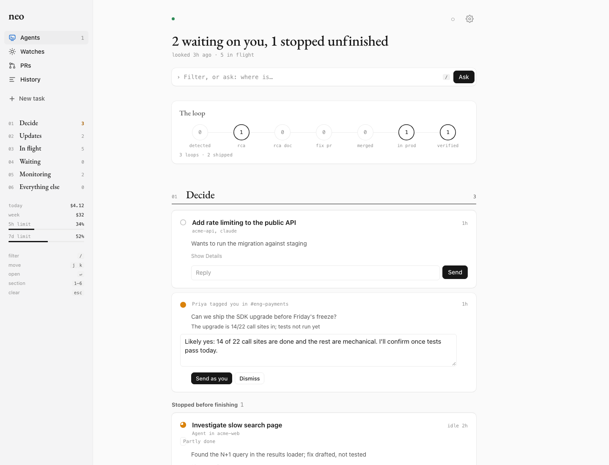
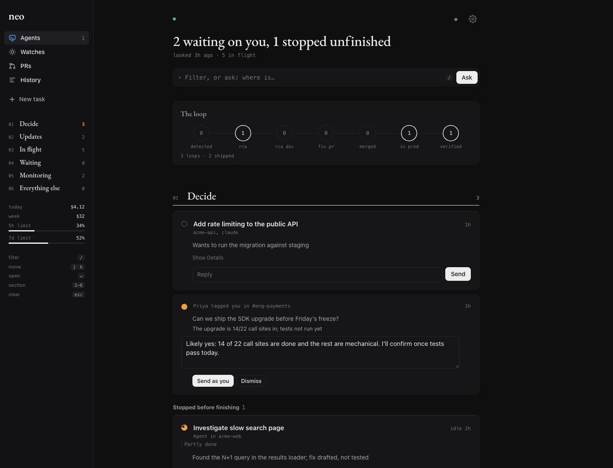
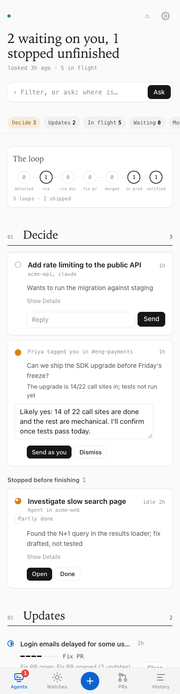

# neo: a chief of staff for your coding agents

Run Claude Code and Codex on an always-on Mac (the Mac mini), drive them from Slack,
and see every agent on that machine in one dashboard -- from your phone.

**On a Mac and just want to try it?** Install the [neo app](macos/README.md): a menu bar app with the
dashboard in a window, no Slack, Python or setup scripts needed.

```bash
curl -fsSL https://raw.githubusercontent.com/898anil/neo/main/macos/install.sh | bash
```

It uses what the tools already do natively and adds only the glue:

| Need | Native feature used |
|---|---|
| Run agents without API keys | the `claude` / `codex` CLIs you are logged into (your subscriptions) |
| Structured, step-by-step output | `claude -p --output-format stream-json`, `codex exec --json`, and each CLI's session transcript on disk |
| Agents that survive you closing the laptop, and that you can take over | [herdr](https://herdr.dev) (persistent terminals, agent state: working / blocked / done) |
| Continue a live Claude session on your phone | Claude Code **Remote Control** (`--remote-control`), opens in the Claude app |
| Remote access | Tailscale |
| Chat + push notifications | Slack (Socket Mode: no public URL) |

## Screenshots

The dashboard home, shown with demo data: what needs a decision, what changed since you last
looked, what is in flight, and the alert-to-fix loop.

| Light | Dark | Phone |
|---|---|---|
|  |  |  |

## Using it

**From Slack** (any channel @neo is in):

| Message | What happens |
|---|---|
| `@neo <task>` | Default engine, headless. One message lists each step live; the answer follows as a reply. |
| `@neo claude <task>` / `@neo codex <task>` | Pick the engine. |
| `@neo cwd=~/path/to/repo <task>` | Pick the working folder. |
| `@neo live claude <task>` | A real interactive agent in herdr. The thread gets links to take over in the dashboard, the Claude app, or a terminal. |
| reply `@neo <message>` | Continue the same session. |
| `@neo stop` / `status` / `close` | Interrupt, check, or end the run. |
| `@neo approve` / `deny` / `keys 2 enter` | Answer a live agent waiting for approval. |
| `@neo remember <rule>` / `@neo remember in <repo>: <rule>` | Add to neo's memory; every agent started after that knows it. |
| `@neo memory` | Show what neo remembers. |
| `@neo help` | This list. |

**Push notifications.** The bot DMs you when *any* agent on the machine -- including ones
you started yourself in herdr -- is waiting for approval, ends its turn with a question,
or finishes a task that took over a minute. Each DM links to the agent in the dashboard
and, for Claude, in the Claude app. (Agents started from a Slack thread report in that
thread instead.) Tune with `NEO_NOTIFY_USER`, `NEO_NOTIFY_MIN_WORK_SECONDS`, `NEO_NOTIFY=0`.

**Your day, from the phone** (the dashboard, installable to the home screen):

| Tab | What it gives you |
|---|---|
| **Now** | One sentence: what needs you. The **Today** brief (written every weekday at 08:30 from your calendar, mail, Slack, GitHub, Sentry and agents; *Refresh* any time). Approvals and questions with Approve / Deny / inline reply. What's working. |
| **Agents** | Every herdr agent on the Mac mini, yours and neo's, with what each said last. Tap for the chat, the live terminal, and quick replies. |
| **Work** | Pull requests waiting for your review and your own PRs with CI and review state. *Review with Claude*, *Fix CI with Claude* (a live agent in its own worktree that asks before pushing), *Merge* (approved + green only, tap twice). |
| **History** | Every task with its cost; today's and this week's spend; Claude's 5-hour and weekly limit usage; **search every Claude and Codex conversation on the machine** and *continue* any of them as a live agent. |
| **+** | Start a task: Claude or Codex, live or in the background, in a folder or **on a new branch** (a fresh worktree off main). |

**Default agent.** The gear on Now (or `@neo default codex` / `@neo default claude` in Slack) sets the agent
used when you don't name one: Slack mentions, +, PR reviews and fixes, and work on findings. It is stored in
`settings.json` and wins over `NEO_DEFAULT_ENGINE`.

**Watches** (Work tab) are standing checks on a schedule: *Sentry* (new and regressed production issues) is on
by default every 2 hours in work hours (Mon-Fri 08:00-20:00), and so is *Production errors* (`gcloud logging`
on the project in `NEO_GCP_PROD_PROJECT`) when that is set; *CI on main* (the `NEO_GITHUB_ORG` repositories, or
those under the working directory) is there but off. The built-in watches are written to `watches.json` the
first time; edit them on the Work tab after that. Add your own in plain words. Each check is a
headless Claude run that **can only read** (its tools are limited with `--allowedTools`; Sentry's
`update_issue` is refused; add more read tools with `NEO_WATCH_TOOLS`) and answers in a fixed JSON shape
(`--json-schema`), so every finding has a severity, what and impact, evidence, a link, the repo, and a
suggested next step. The same problem is recognised across checks by its key and never reported twice.

New findings appear on **Now** (*Start working on it* opens + pre-filled: your default agent, live, on a new
branch in the right local clone, with the suggested fix as the task; *Dismiss* when handled) and in Slack
(non-low severity only; reply `@neo live fix 1` in that thread). `@neo watches` lists what is open. The
morning brief includes open findings.

Also: a Slack ping when an agent has shown no activity for 15 minutes while working (`NEO_STUCK_MINUTES`),
and optional **automatic RCA**: set `NEO_AUTO_RCA_CHANNELS` to alert channel ids and every new alert gets
a Claude RCA in its thread (repeats within 30 minutes are skipped; `NEO_AUTO_RCA_DAILY_MAX`, default 10).
The brief's time is `NEO_BRIEF_AT` (default 08:30, weekdays; `off` to disable); its instructions are in
`prompts/brief.md`, and every agent's standing instructions in `prompts/slack-agent.md`.

## Memory

Every Claude or Codex session starts blank, so you end up re-explaining the same things: which
service is flaky, what was already tried, the rule you set last week. neo keeps a memory of its own,
outside any one agent, so it survives switching between Claude and Codex.

**What it learns from.** Mostly two things:

- *Mistakes.* When a session you drove fails, only half works, or you correct the agent, neo writes a
  one-line lesson: what went wrong and what to do instead ("Prod checks fail without the prod exit
  node: set it first"). Routine work that went fine leaves nothing behind.
- *What you tell it.* Rules, preferences, decisions and corrections from your own messages, kept close
  to your words, or added directly with `@neo remember ...`.

Both come out of the call neo already makes to summarise each finished session (the decision card),
so learning costs no extra model call. Only sessions you drove can write memory: live agents and tasks
you start from Slack or the dashboard. Automatic alert investigations, the mentions check and
scheduled watches read other people's text, so they never write to it.

**Where it lives.** Plain Markdown in `NEO_MEMORY_DIR` (default `~/.neo/memory`), so you can read,
edit, delete and version it like any notes:

```
~/.neo/memory/
  me.md              your rules, preferences and decisions
  lessons.md         mistakes: what went wrong, what to do instead
  repos/<repo>.md    rules and lessons that only hold in one repository
```

Each entry is one bullet, with its date and source in a hidden comment:
`- Run migrations with make migrate <!-- 2026-10-11 rule slack:C123/1791.2 -->`

**How agents get it.** When neo starts any agent, it adds a short memory section (about 6,000
characters at most) to the agent's standing instructions: your rules, then notes for the repository
it works in (worktrees count as their repo), then the newest lessons. Claude gets it as a system
prompt, Codex at the top of its first message. Memory is notes, not orders: the agent is told that
your current request wins over anything remembered. See it on the dashboard (History, *What neo
remembers*) or with `@neo memory`. A failed memory write never affects the task.

Not to be confused with search: History also searches every Claude and Codex transcript on the
machine and lets you continue any of them.

**The dashboard** (phone-first, one page):

- *Needs you*: agents waiting for approval (Approve / Deny) or asking a question (reply inline)
- *Agents*: every herdr agent on the machine (yours and the bot's): state, repo, what it said last
- *Agent page*: full step-by-step timeline from its transcript, live terminal screen, reply box,
  Esc to interrupt, links to the Slack thread and the Claude app
- *Headless runs*: every `claude -p` / `codex exec` run, with a live timeline, follow-ups and stop
- *+ New*: start a live or headless task

## Install / update (on the Mac mini)

```bash
cd ~/Documents/projects/slack-claude-bot
cp .env.example .env    # first time only: add SLACK_BOT_TOKEN, SLACK_APP_TOKEN, ALLOWED_USER_IDS
deploy/install.sh
```

The installer is idempotent: it installs herdr if missing, the Python dependencies,
runs the tests, sets up dashboard access (below), and (re)loads the launchd agent
`com.neo.slack-bot` (set `NEO_LAUNCHD_LABEL` in `.env` to use another label). Logs: `~/Library/Logs/neo-slack-bot.log`.

To update after pushing changes from a laptop: `ssh mini 'cd ~/Documents/projects/slack-claude-bot && git pull --ff-only && deploy/install.sh'`.
Runtime state (`runs/`, the `*.json` state files, `.env`, `private/`) is gitignored, so a pull never touches it.

### Dashboard access

The installer tries, in order:

1. **Tailscale Serve** (preferred): `https://<mini>.<tailnet>.ts.net`, HTTPS, signed in by your
   Tailscale identity (`COS_TAILSCALE_USERS`). Needs Serve enabled for the tailnet (one-time
   admin step; the installer prints the link) and the tailnet policy to allow port 443 to the mini.
2. **Fallback**: listens on the mini's Tailscale address only (never the LAN), port 8788, with
   `COS_TOKEN`. Open `http://<mini>.<tailnet>.ts.net:8788/?token=<COS_TOKEN>` once on each device;
   it is remembered for 30 days. The tailnet policy must allow that port.

If the tailnet policy only allows SSH, use a tunnel from a laptop:
`ssh -N -L 8788:<mini tailscale ip>:8788 mini`, then open `http://localhost:8788/?token=...`.

## How it works

```
Slack ─┐                                  ┌─ headless: claude -p / codex exec (JSON stream)
Dash  ─┼─▶ app.py (Socket Mode) ─▶ cos/ ──┤
       │                                  └─ live: herdr session "neo" ── Claude / Codex TUI
       │                                        ├─ herdr state: working / blocked / done
       │                                        ├─ transcript on disk (~/.claude, ~/.codex)
       │                                        └─ Remote Control link (Claude app)
       └── monitor: every herdr agent (all sessions) ─▶ Slack DM when one needs you
```

- `app.py` -- Slack handler, live-thread bridge, notification monitor, serves the dashboard.
- `commands.py` -- message grammar and the Slack progress renderer.
- `sessions.py` -- Slack thread -> run mapping.
- `cos/events.py` -- Claude/Codex stream and transcript lines -> one event format.
- `cos/runner.py` -- headless runs; `cos/interactive.py` + `cos/herdr.py` -- live runs.
- `cos/fleet.py` -- everything on the machine: all herdr agents, their transcripts, runs.
- `cos/watches.py` -- watches and findings; `cos/settings.py` -- choices made from the dashboard.
- `cos/server.py` + `cos/static/index.html` -- the dashboard. `python -m cos` is also a CLI.

Live runs use their own herdr session (`neo`); your own agents stay in your default session
and are shown and controllable, never restarted. Attach: `herdr session attach neo`.

Tests: `poetry run python -m unittest discover -s tests`

## Security

- `ALLOWED_USER_IDS` is the gate for Slack; never leave it empty in a shared workspace.
- Headless runs default to `NEO_MODE=full` (no approval prompts, as the bot always ran);
  `NEO_MODE=edit` or `readonly` tightens that. Live runs use each CLI's own permission settings.
- Thread text is passed to agents as context: treat alert/bot messages as untrusted input.
- The dashboard can start and steer agents. It only answers localhost, allowed Tailscale
  logins, or `COS_TOKEN`; cross-site requests are refused. Rotate the token by deleting
  `COS_TOKEN` from `.env` and rerunning the installer.

`neo_viewer.py` / `neo-logs` read the older `transcripts/*.log` files from the Codex-only
version; everything since is in `runs/` and the dashboard.

## License

MIT. See [LICENSE](LICENSE).
